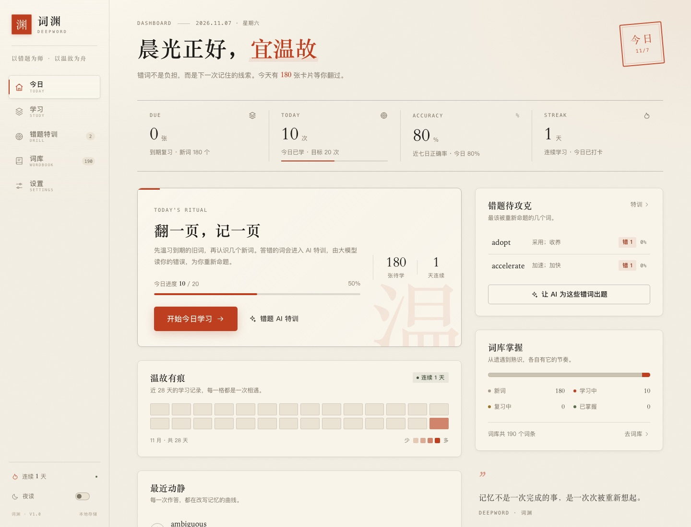
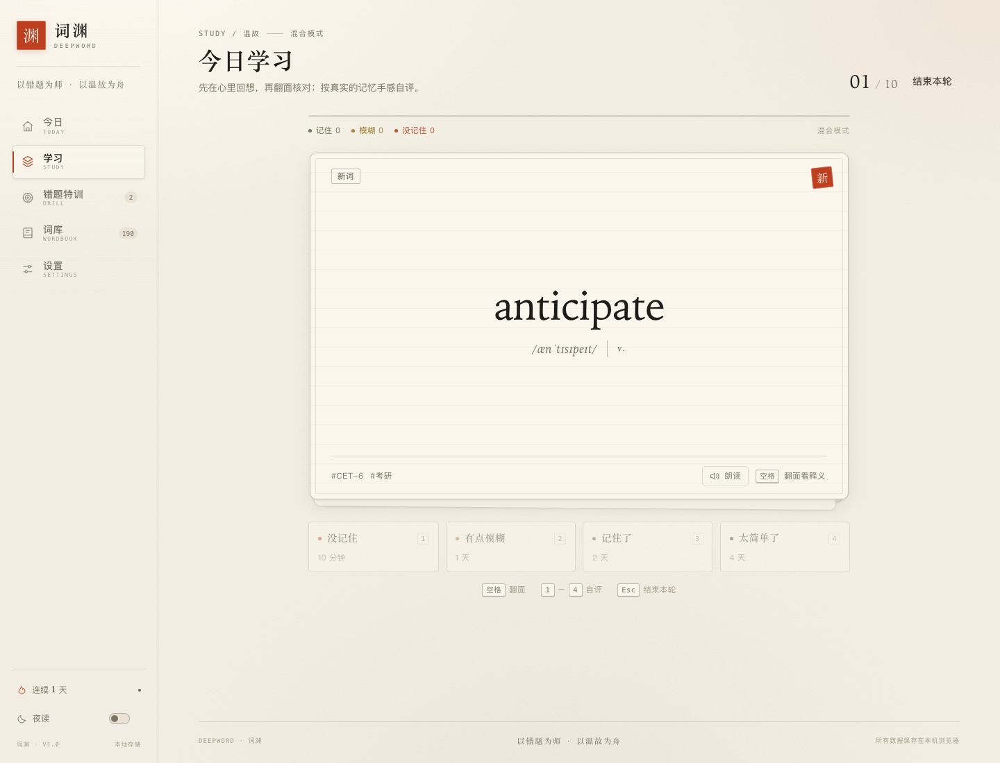
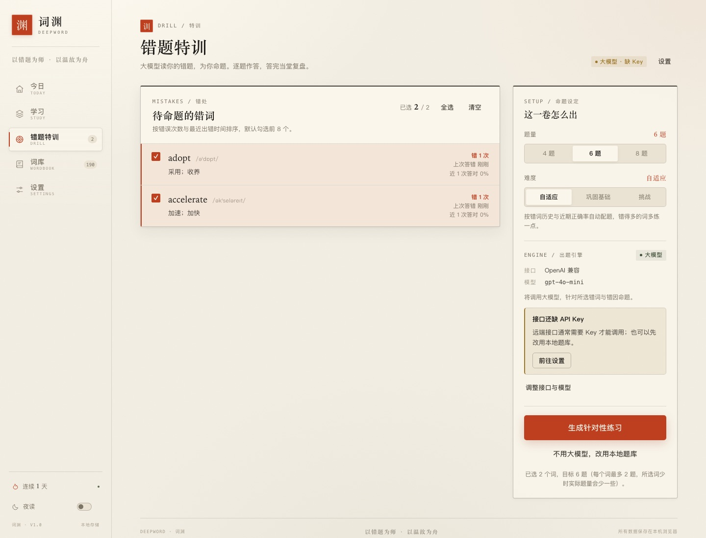
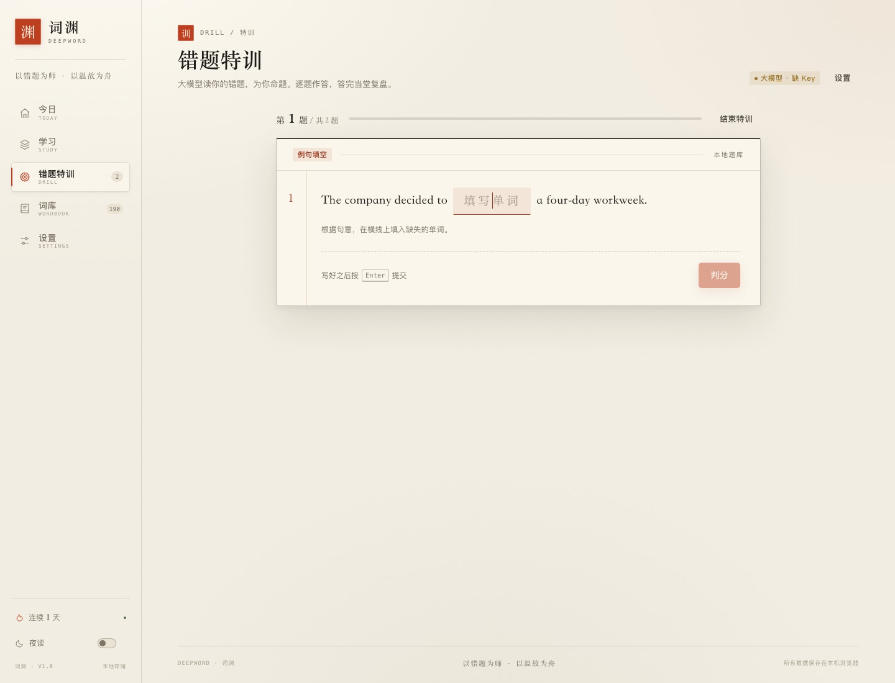
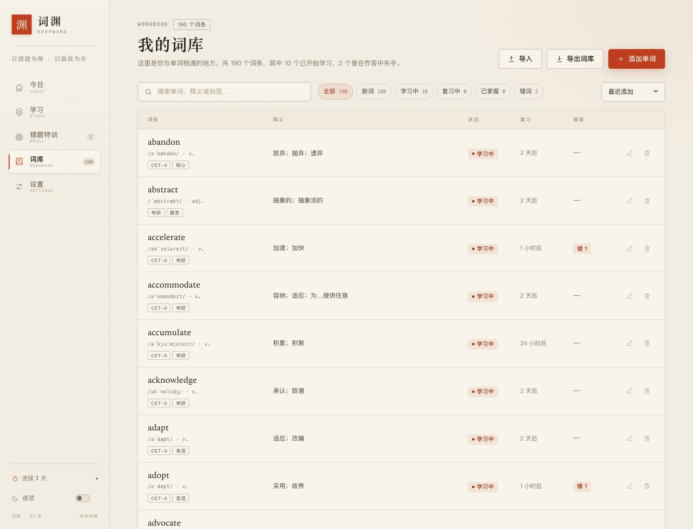
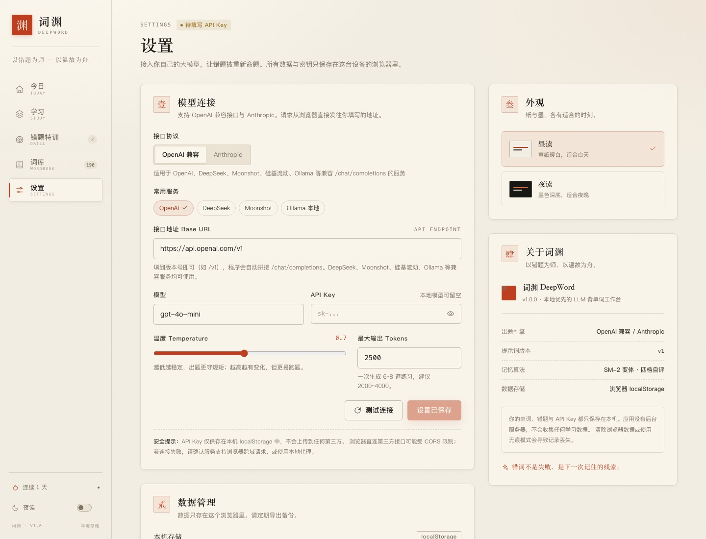
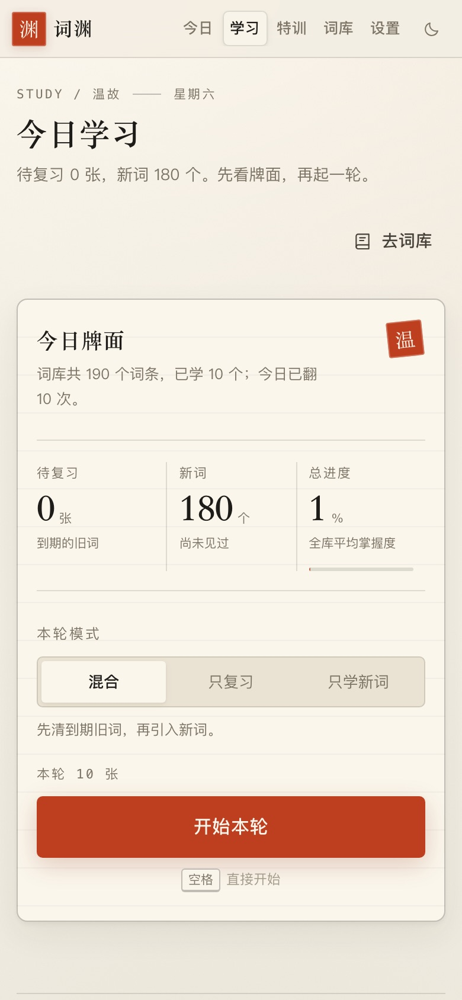
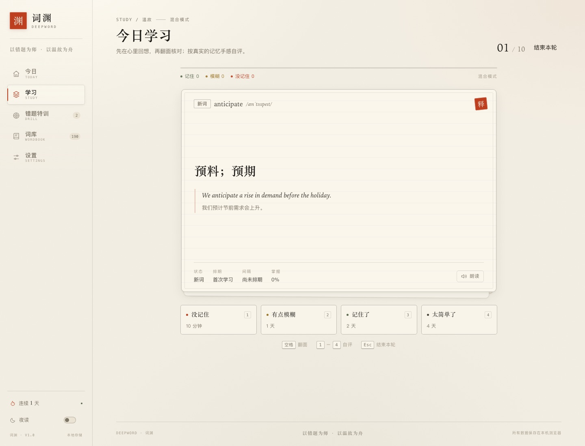

# 词渊 DeepWord

> 以错题为师，以温故为舟。

一个**本地优先**的 LLM 背单词 Web 应用。用闪卡做间隔重复，把答错的词收进错题本，再让大模型读着你的错误史，为你重新命题 —— 每一道题都针对你真正没记住的地方。

前端为 React 19 + Vite + TypeScript，数据只保存在浏览器 localStorage，API 兼容 OpenAI 与 Anthropic 两种协议，可直接使用 DeepSeek、Moonshot、硅基流动、Ollama 等兼容服务。

## 界面预览

| 今日 · 仪表盘 | 闪卡 · 温故 |
| --- | --- |
|  |  |
| **错题特训 · 选词与命题** | **本地兜底 · 例句填空** |
|  |  |

| 词库 | 设置 |
| --- | --- |
|  |  |

<table>
  <tr>
    <td align="center"><br /><sub>移动端 · 今日</sub></td>
    <td align="center"><br /><sub>移动端 · 学习</sub></td>
    <td align="center"><br /><sub>闪卡背面 · 释义与例句</sub></td>
  </tr>
</table>

---

## 功能

- **闪卡 + SRS 间隔重复**：四档自评（没记住 / 有点模糊 / 记住了 / 太简单），SM-2 变体排程；支持键盘 `Space` 翻面、`1-4` 评分、发音朗读。
- **错题本**：记录每个词的错误次数、连续答对、最近错因与题型；按「待攻克 / 已连对」排序。
- **LLM 针对性出题**：从错题中选词，把词义、例句、错因、近期正确率交给模型，生成四选一、例句填空、用法辨析、句子纠错等**可自动判分**的练习；逐题判分、中文解析、结果复盘。
- **本地兜底题库**：没有配置 API Key 或调用失败时，自动改用词库自身生成练习，离线也能刷。
- **词库管理**：内置 190 个 CET-4 / CET-6 / 考研 / 雅思高频词；支持搜索、按学习状态筛选、排序、添加/编辑/删除、JSON 导入导出。
- **仪表盘**：到期卡片、今日进度、近七日正确率、连续学习天数、28 天热力图、错题待攻克、掌握度分布。
- **设置**：OpenAI 兼容 / Anthropic 双协议，Base URL、模型、Key、温度、最大 Tokens 配置，连接测试；完整备份导入导出；昼读 / 夜读主题。
- **数据自持**：无后端、无账号、无埋点。单词、错题、API Key 都只存在当前浏览器的 localStorage 中。

## 快速开始

```bash
pnpm install
pnpm dev        # http://127.0.0.1:5173
```

生产构建与预览：

```bash
pnpm build
pnpm preview
```

测试与类型检查：

```bash
pnpm test       # vitest：129 个用例，覆盖 SRS / 统计 / 会话 / 存储 / 本地出题 / LLM 解析与校验
pnpm typecheck
```

## 配置大模型

打开左下角「设置 → 模型连接」：

| 协议 | Base URL 示例 | 模型示例 |
| --- | --- | --- |
| OpenAI 兼容 | `https://api.openai.com/v1` | `gpt-4o-mini` |
| OpenAI 兼容（DeepSeek） | `https://api.deepseek.com/v1` | `deepseek-chat` |
| OpenAI 兼容（Moonshot） | `https://api.moonshot.cn/v1` | `moonshot-v1-8k` |
| OpenAI 兼容（Ollama 本地） | `http://localhost:11434/v1` | `qwen2.5:7b` |
| Anthropic | `https://api.anthropic.com/v1` | `claude-sonnet-4-5` |

- 填写到版本号（如 `/v1`）即可，程序会自动拼接 `/chat/completions` 或 `/messages`。
- 本地 Ollama 可以不填 API Key；若遇到跨域错误，需要允许来源（例如设置 `OLLAMA_ORIGINS=*`）。
- Anthropic 浏览器直连会自动携带 `anthropic-dangerous-direct-browser-access: true`。
- 可先点「测试连接」验证；出题失败时页面会给出原因并可一键改用本地题库。

> **安全提示**：这是本地个人工具，API Key 保存在浏览器 localStorage 中。出于成本与安全考虑，不建议把带 Key 的页面部署到公网。请勿在公共电脑上保存 Key，并定期轮换。

## 浏览器的跨域限制（CORS）

应用直接从浏览器请求你配置的接口地址，因此目标服务必须允许跨域。如果连接测试失败：

1. 确认 Base URL、模型名与 Key 正确；
2. 确认服务商允许浏览器直连（部分厂商默认禁止）；
3. 使用本地 Ollama / LM Studio / 自建网关，或通过自己的反向代理转发请求。

## 项目结构

```
src/
├── types.ts                 # 领域类型（唯一契约来源）
├── App.tsx                  # 路由（hash）+ 应用外壳
├── state/AppState.tsx       # 全局数据、写操作、持久化、Toast
├── lib/
│   ├── srs.ts               # SM-2 变体记忆排程
│   ├── session.ts           # 学习队列
│   ├── stats.ts             # 仪表盘、错题、薄弱词统计
│   ├── storage.ts           # localStorage / 备份导入导出 / 清洗
│   ├── fallbackExercises.ts # 本地兜底出题
│   └── llm/                 # OpenAI 兼容 + Anthropic 传输、提示词、校验
├── data/wordbank.ts         # 内置示例词库
├── components/
│   ├── Dashboard.tsx        # 今日
│   ├── study/               # 闪卡学习
│   ├── drill/               # 错题 AI 特训
│   ├── WordbookView.tsx     # 词库
│   ├── SettingsView.tsx     # 设置
│   └── ui/                  # 通用弹窗、图标、Toast
└── styles/                  # 设计变量、基础排版、共享组件样式
```

## 设计说明

界面取「宣纸 × 墨色 × 朱砂」的意象：宋体标题、衬线英文词、纸张颗粒纹理、细墨线边框、朱砂色只用于真正需要注意的地方（到期、错误、行动）。支持昼读 / 夜读两套主题与移动端布局。

## 已知边界

- 数据存在 localStorage，受浏览器配额限制（通常 5 MB）；清除站点数据会丢失记录，建议定期在设置中导出备份。
- LLM 输出经过严格校验，模型表现不佳时单次生成的题量可能少于请求数量。
- 所有 LLM 网络链路均以契约一致的 mock 服务验证（OpenAI 兼容 + Anthropic 两条协议、失败回退、Key 不泄漏），真实接口行为取决于服务商实现与 CORS 配置。
- 数据无多标签页实时同步（同一浏览器多个标签页同时编辑时以最后写入为准）；暂无账号系统与跨设备同步。

## 文档

| 文档 | 内容 |
| --- | --- |
| [CHANGELOG.md](CHANGELOG.md) | 版本更新日志（Keep a Changelog / SemVer） |
| [docs/spec.md](docs/spec.md) | 产品需求与验收规格：视图、功能行为、判定规则、验收清单 |
| [docs/architecture.md](docs/architecture.md) | 架构与数据流：分层、状态管理、持久化、LLM 层细节、测试策略 |
| [docs/version-spec.md](docs/version-spec.md) | 版本规格：应用 / 数据 / 提示词三条版本线、迁移规则、发布流程 |
| [docs/agents.md](docs/agents.md) | 协作分工：Lead 与各代理的职责边界、协作机制、迭代复用方式 |

## License

个人学习项目，仅供学习与自用。
